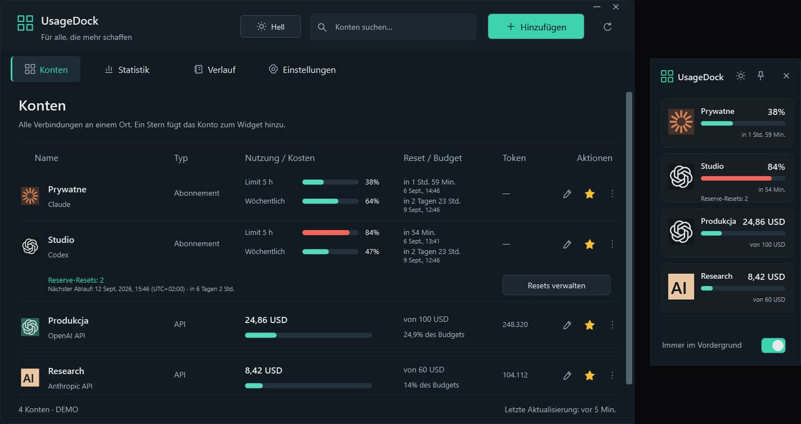

<a href="https://github.com/legitedeV/legitedeV/blob/main/README.md">English</a> · <a href="https://github.com/legitedeV/legitedeV/blob/main/README.pl.md">Polski</a> · <b>Deutsch</b> · <a href="https://github.com/legitedeV/legitedeV/blob/main/README.es.md">Español</a> · <a href="https://github.com/legitedeV/legitedeV/blob/main/README.fr.md">Français</a> · <a href="https://github.com/legitedeV/legitedeV/blob/main/README.it.md">Italiano</a> · <a href="https://github.com/legitedeV/legitedeV/blob/main/README.pt.md">Português</a> · <a href="https://github.com/legitedeV/legitedeV/blob/main/README.uk.md">Українська</a> · <a href="https://github.com/legitedeV/legitedeV/blob/main/README.zh.md">中文</a>

  

<h1 align="center">made by ALUK · Sebastian Aluk</h1>

<b>Ich entwerfe und baue Websites, Onlineshops und Web-Apps. Allein, vom ersten Gespräch bis zum Start.</b>

  
  
  

Ich führe ALUK aus Stettin (Szczecin), Polen. Entwurf, Code und Antworten auf Nachrichten kommen von mir. Kein Vertrieb, keine Vermittler. Alles schriftlich. Code, Domain und Zugänge gehören Ihnen ab der ersten Übergabe.

## So arbeite ich

1. **Kennenlernen.** Wir sprechen online. Ich frage nach Ihrem Ziel, Ihren Kunden und Ihrer Konkurrenz.
2. **Vorschau.** Ich zeige, wie die Seite aussehen wird. Bevor ich einen Preis nenne.
3. **Angebot.** Ein Preis, schriftlich. Nach Ihrer Zusage ändert er sich nicht. Ich beginne nach 50 % Anzahlung.
4. **Umsetzung.** Ich schreibe den Code. Einen Vorschau-Link haben Sie die ganze Zeit.
5. **Start.** Sie nehmen die Seite ab und zahlen die zweite Hälfte. Dann veröffentliche ich sie. 30 Tage lang behebe ich Fehler ohne Aufpreis.

## Erste Projekte

Mein Portfolio besteht bisher aus Konzepten. Jetzt möchte ich Seiten zeigen, die für echte Firmen arbeiten. Deshalb baue ich die ersten paar günstiger. Im Gegenzug bitte ich um drei Dinge:

- die Erlaubnis, die Seite im Portfolio zu zeigen,
- eine Google-Bewertung, sobald die Seite läuft,
- einen Link „Design und Umsetzung: madebyaluk.pl“ im Footer.

**[Erzählen Sie mir von Ihrer Firma](https://madebyaluk.pl/kontakt?utm_source=github&utm_medium=social&utm_campaign=marka-2026q4)**

## Erfundene Marken. Echte Websites.

Die Marken habe ich für mein Portfolio erfunden. Jede Seite läuft unter eigener Adresse, Sie können sie öffnen und scrollen. Reines HTML, CSS, GSAP und Lenis, ohne Framework.

<table>
  <tr>
    <td width="50%" valign="top">
      
      <b><a href="https://halda.madebyaluk.pl">Halda</a> · Serum-Marke</b> 
      Am Anfang ein Tropfen. Beim Scrollen dreht sich die Flasche und zeigt drei Wirkstoffe.
    </td>
    <td width="50%" valign="top">
      
      <b><a href="https://osnowa.madebyaluk.pl">Osnowa</a> · Architekturbüro</b> 
      Ein Pavillon im Nebel. Projekte wechseln mit harten Schnitten wie im Film. Der Grundriss zeichnet sich beim Scrollen.
    </td>
  </tr>
  <tr>
    <td width="50%" valign="top">
      
      <b><a href="https://nurt.madebyaluk.pl">Nurt</a> · Geschäftskonto</b> 
      Beim Scrollen setzen sich Kacheln zum App-Bildschirm zusammen. Das Prognose-Diagramm zeichnet sich selbst.
    </td>
    <td width="50%" valign="top">
      
      <b><a href="https://zgielk.madebyaluk.pl">ZGIEŁK</a> · Musikfestival</b> 
      Die Buchstaben des Titels reagieren auf Maus und Scrollen. Dann Line-up, Countdown und Tickets.
    </td>
  </tr>
  <tr>
    <td width="50%" valign="top">
      
      <b><a href="https://kancelaria.madebyaluk.pl">Sowa &amp; Wróbel</a> · Kanzlei, zwei Versionen</b> 
      Dieselbe Seite zweimal. Version A ohne jedes Skript. Version B mit dezenter Bewegung.
    </td>
    <td width="50%" valign="top">
      
      <b><a href="https://madebyaluk.pl/?utm_source=github&utm_medium=social&utm_campaign=marka-2026q4">madebyaluk.pl</a> · meine Studio-Website</b> 
      Next.js, React, TypeScript, Tailwind. Kostenloser Website-Audit, Projektpanel für Kunden, kurzes Kontaktformular.
    </td>
  </tr>
</table>

## Open Source

**[UsageDock](https://github.com/legitedeV/UsageDock)** · Windows, C# / WPF, .NET 8, MIT. Limits von Claude und Codex, gesparte Codex-Resets und API-Ausgaben in einem nativen Windows-Fenster und einem Widget, das immer oben bleibt. Fünf Sprachen, helles und dunkles Design. Schlüssel bleiben verschlüsselt auf Ihrem Rechner. Kein eigener Server, keine Telemetrie. [Für Windows herunterladen](https://github.com/legitedeV/UsageDock/releases/latest).

- **MaxSwitch**: wechselt automatisch zwischen Claude-Max-Abos, wenn Limits erreicht sind (privates Repo).
- **mcp-humanizer**: MCP-Server, der polnische Texte menschlich klingen lässt, ohne eigene API (privates Repo).

## Werkzeuge

  

---

Ein paar Sätze reichen. Den Rest frage ich nach. Es verpflichtet Sie zu nichts. <a href="mailto:hello@madebyaluk.pl">hello@madebyaluk.pl</a> · <a href="https://madebyaluk.pl/kontakt?utm_source=github&utm_medium=social&utm_campaign=marka-2026q4">schreiben Sie über madebyaluk.pl</a> · <a href="https://useme.com/pl/roles/contractor/aluk-sebastian-aluk,675100/">Useme</a>

