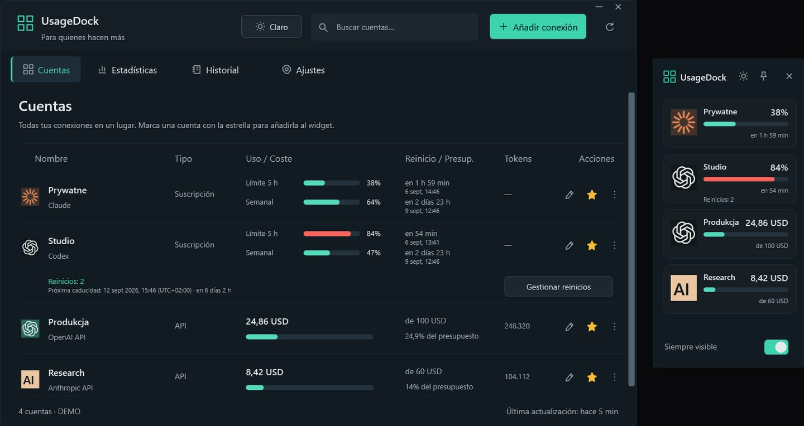

<a href="https://github.com/legitedeV/legitedeV/blob/main/README.md">English</a> · <a href="https://github.com/legitedeV/legitedeV/blob/main/README.pl.md">Polski</a> · <a href="https://github.com/legitedeV/legitedeV/blob/main/README.de.md">Deutsch</a> · <b>Español</b> · <a href="https://github.com/legitedeV/legitedeV/blob/main/README.fr.md">Français</a> · <a href="https://github.com/legitedeV/legitedeV/blob/main/README.it.md">Italiano</a> · <a href="https://github.com/legitedeV/legitedeV/blob/main/README.pt.md">Português</a> · <a href="https://github.com/legitedeV/legitedeV/blob/main/README.uk.md">Українська</a> · <a href="https://github.com/legitedeV/legitedeV/blob/main/README.zh.md">中文</a>

  

<h1 align="center">made by ALUK · Sebastian Aluk</h1>

<b>Diseño y construyo webs, tiendas online y aplicaciones web. Yo solo, desde la primera conversación hasta el lanzamiento.</b>

  
  
  

Dirijo ALUK desde Szczecin, Polonia. Diseño, escribo el código y respondo los mensajes yo mismo. Sin comerciales ni intermediarios. Todo por escrito. El código, el dominio y los accesos son tuyos desde la primera entrega.

## Cómo trabajo

1. **Conocernos.** Hablamos online. Pregunto por tu objetivo, tus clientes y tu competencia.
2. **Vista previa.** Te enseño cómo se verá la web. Antes de darte un precio.
3. **Presupuesto.** Un solo precio, por escrito. No cambia una vez aceptado. Empiezo tras un anticipo del 50 %.
4. **Construcción.** Escribo el código. Tienes un enlace de vista previa todo el tiempo.
5. **Lanzamiento.** Apruebas la web y pagas la otra mitad. Entonces la publico. Corrijo errores 30 días sin coste extra.

## Primeros proyectos

Por ahora mi portfolio son conceptos. Ahora quiero mostrar webs que trabajan para empresas reales. Por eso haré las primeras a un precio más bajo. A cambio pido tres cosas:

- permiso para mostrar la web en mi portfolio,
- una reseña en Google cuando la web esté en marcha,
- un enlace «Diseño y desarrollo: madebyaluk.pl» en el pie de página.

**[Cuéntame sobre tu empresa](https://madebyaluk.pl/kontakt?utm_source=github&utm_medium=social&utm_campaign=marka-2026q4)**

## Marcas inventadas. Webs reales.

Inventé estas marcas para mi portfolio. Cada web está publicada en su propia dirección, puedes abrirla y hacer scroll. HTML, CSS, GSAP y Lenis, sin framework.

<table>
  <tr>
    <td width="50%" valign="top">
      
      <b><a href="https://halda.madebyaluk.pl">Halda</a> · marca de sérum</b> 
      Empieza con una gota. Al hacer scroll, el frasco gira y muestra tres ingredientes.
    </td>
    <td width="50%" valign="top">
      
      <b><a href="https://osnowa.madebyaluk.pl">Osnowa</a> · estudio de arquitectura</b> 
      Un pabellón en la niebla. Los proyectos cambian con cortes secos, como en el cine. El plano se dibuja al hacer scroll.
    </td>
  </tr>
  <tr>
    <td width="50%" valign="top">
      
      <b><a href="https://nurt.madebyaluk.pl">Nurt</a> · cuenta de empresa</b> 
      Al hacer scroll, los paneles se juntan en la pantalla de la app. El gráfico de previsión se dibuja solo.
    </td>
    <td width="50%" valign="top">
      
      <b><a href="https://zgielk.madebyaluk.pl">ZGIEŁK</a> · festival de música</b> 
      Las letras del título reaccionan al ratón y al scroll. Luego el cartel, la cuenta atrás y las entradas.
    </td>
  </tr>
  <tr>
    <td width="50%" valign="top">
      
      <b><a href="https://kancelaria.madebyaluk.pl">Sowa &amp; Wróbel</a> · bufete, dos versiones</b> 
      La misma web dos veces. La versión A no tiene ningún script. La versión B tiene movimiento sutil.
    </td>
    <td width="50%" valign="top">
      
      <b><a href="https://madebyaluk.pl/?utm_source=github&utm_medium=social&utm_campaign=marka-2026q4">madebyaluk.pl</a> · la web de mi estudio</b> 
      Next.js, React, TypeScript, Tailwind. Auditoría web gratuita, panel de proyecto para clientes, formulario breve.
    </td>
  </tr>
</table>

## Código abierto

**[UsageDock](https://github.com/legitedeV/UsageDock)** · Windows, C# / WPF, .NET 8, MIT. Límites de Claude y Codex, reinicios de Codex guardados y gasto en API en una ventana nativa de Windows y un widget siempre visible. Cinco idiomas, tema claro y oscuro. Las claves quedan cifradas en tu ordenador. Sin servidor propio ni telemetría. [Descargar para Windows](https://github.com/legitedeV/UsageDock/releases/latest).

- **MaxSwitch**: cambia solo entre suscripciones Claude Max cuando se agotan los límites (repo privado).
- **mcp-humanizer**: servidor MCP que hace que el texto en polaco suene humano, sin API propia (repo privado).

## Herramientas

  

---

Bastan unas frases. El resto lo pregunto yo. No te compromete a nada. <a href="mailto:hello@madebyaluk.pl">hello@madebyaluk.pl</a> · <a href="https://madebyaluk.pl/kontakt?utm_source=github&utm_medium=social&utm_campaign=marka-2026q4">escríbeme en madebyaluk.pl</a> · <a href="https://useme.com/pl/roles/contractor/aluk-sebastian-aluk,675100/">Useme</a>

