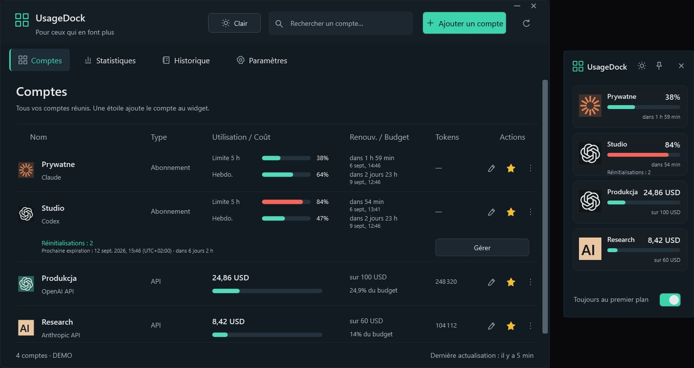

<a href="https://github.com/legitedeV/legitedeV/blob/main/README.md">English</a> · <a href="https://github.com/legitedeV/legitedeV/blob/main/README.pl.md">Polski</a> · <a href="https://github.com/legitedeV/legitedeV/blob/main/README.de.md">Deutsch</a> · <a href="https://github.com/legitedeV/legitedeV/blob/main/README.es.md">Español</a> · <b>Français</b> · <a href="https://github.com/legitedeV/legitedeV/blob/main/README.it.md">Italiano</a> · <a href="https://github.com/legitedeV/legitedeV/blob/main/README.pt.md">Português</a> · <a href="https://github.com/legitedeV/legitedeV/blob/main/README.uk.md">Українська</a> · <a href="https://github.com/legitedeV/legitedeV/blob/main/README.zh.md">中文</a>

  

<h1 align="center">made by ALUK · Sebastian Aluk</h1>

<b>Je conçois et je développe des sites, des boutiques en ligne et des applications web. Seul, du premier échange jusqu’à la mise en ligne.</b>

  
  
  

Je dirige ALUK depuis Szczecin, en Pologne. Je conçois, j’écris le code et je réponds moi-même aux messages. Pas de commercial, pas d’intermédiaire. Tout par écrit. Le code, le domaine et les accès sont à vous dès la première livraison.

## Comment je travaille

1. **Faire connaissance.** On se parle en ligne. Je vous interroge sur votre objectif, vos clients et vos concurrents.
2. **Aperçu.** Je vous montre à quoi ressemblera le site. Avant de donner un prix.
3. **Devis.** Un seul prix, par écrit. Il ne change plus une fois accepté. Je commence après un acompte de 50 %.
4. **Réalisation.** J’écris le code. Vous avez un lien d’aperçu tout du long.
5. **Lancement.** Vous validez le site et réglez la seconde moitié. Je le mets alors en ligne. Je corrige les bugs pendant 30 jours sans frais.

## Premiers projets

Pour l’instant, mon portfolio ne contient que des concepts. Je veux maintenant montrer des sites qui travaillent pour de vraies entreprises. Je réaliserai donc les premiers à prix réduit. En échange, je demande trois choses :

- l’accord pour montrer le site dans mon portfolio,
- un avis Google une fois le site en ligne,
- un lien « Conception et réalisation : madebyaluk.pl » en pied de page.

**[Parlez-moi de votre entreprise](https://madebyaluk.pl/kontakt?utm_source=github&utm_medium=social&utm_campaign=marka-2026q4)**

## Des marques inventées. De vrais sites.

J’ai inventé ces marques pour mon portfolio. Chaque site est en ligne à sa propre adresse, vous pouvez l’ouvrir et le faire défiler. HTML, CSS, GSAP et Lenis, sans framework.

<table>
  <tr>
    <td width="50%" valign="top">
      
      <b><a href="https://halda.madebyaluk.pl">Halda</a> · marque de sérum</b> 
      Tout commence par une goutte. Au défilement, le flacon tourne et montre trois ingrédients.
    </td>
    <td width="50%" valign="top">
      
      <b><a href="https://osnowa.madebyaluk.pl">Osnowa</a> · agence d’architecture</b> 
      Un pavillon dans la brume. Les projets s’enchaînent en coupes franches, comme au cinéma. Le plan se dessine au défilement.
    </td>
  </tr>
  <tr>
    <td width="50%" valign="top">
      
      <b><a href="https://nurt.madebyaluk.pl">Nurt</a> · compte professionnel</b> 
      Au défilement, les tuiles s’assemblent en écran d’application. Le graphique de prévision se dessine tout seul.
    </td>
    <td width="50%" valign="top">
      
      <b><a href="https://zgielk.madebyaluk.pl">ZGIEŁK</a> · festival de musique</b> 
      Les lettres du titre réagissent à la souris et au défilement. Puis la programmation, le compte à rebours et les billets.
    </td>
  </tr>
  <tr>
    <td width="50%" valign="top">
      
      <b><a href="https://kancelaria.madebyaluk.pl">Sowa &amp; Wróbel</a> · cabinet d’avocats, deux versions</b> 
      Le même site deux fois. La version A n’a aucun script. La version B a un mouvement discret.
    </td>
    <td width="50%" valign="top">
      
      <b><a href="https://madebyaluk.pl/?utm_source=github&utm_medium=social&utm_campaign=marka-2026q4">madebyaluk.pl</a> · le site de mon studio</b> 
      Next.js, React, TypeScript, Tailwind. Audit de site gratuit, espace projet pour les clients, formulaire court.
    </td>
  </tr>
</table>

## Open source

**[UsageDock](https://github.com/legitedeV/UsageDock)** · Windows, C# / WPF, .NET 8, MIT. Limites Claude et Codex, réinitialisations Codex en réserve et dépenses API dans une fenêtre Windows native et un widget toujours au premier plan. Cinq langues, thème clair et sombre. Les clés restent chiffrées sur votre ordinateur. Pas de serveur propre, pas de télémétrie. [Télécharger pour Windows](https://github.com/legitedeV/UsageDock/releases/latest).

- **MaxSwitch**: bascule seul entre abonnements Claude Max quand les limites sont atteintes (dépôt privé).
- **mcp-humanizer**: serveur MCP qui rend un texte polonais plus humain, sans API propre (dépôt privé).

## Outils

  

---

Quelques phrases suffisent. Je vous demanderai le reste. Cela ne vous engage à rien. <a href="mailto:hello@madebyaluk.pl">hello@madebyaluk.pl</a> · <a href="https://madebyaluk.pl/kontakt?utm_source=github&utm_medium=social&utm_campaign=marka-2026q4">écrivez-moi via madebyaluk.pl</a> · <a href="https://useme.com/pl/roles/contractor/aluk-sebastian-aluk,675100/">Useme</a>

