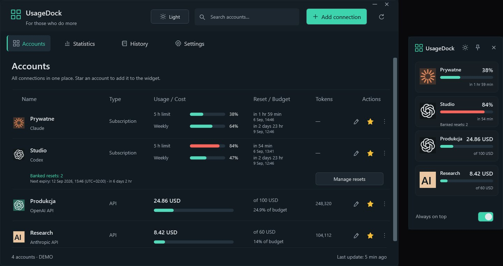

<a href="https://github.com/legitedeV/legitedeV/blob/main/README.md">English</a> · <a href="https://github.com/legitedeV/legitedeV/blob/main/README.pl.md">Polski</a> · <a href="https://github.com/legitedeV/legitedeV/blob/main/README.de.md">Deutsch</a> · <a href="https://github.com/legitedeV/legitedeV/blob/main/README.es.md">Español</a> · <a href="https://github.com/legitedeV/legitedeV/blob/main/README.fr.md">Français</a> · <b>Italiano</b> · <a href="https://github.com/legitedeV/legitedeV/blob/main/README.pt.md">Português</a> · <a href="https://github.com/legitedeV/legitedeV/blob/main/README.uk.md">Українська</a> · <a href="https://github.com/legitedeV/legitedeV/blob/main/README.zh.md">中文</a>

  

<h1 align="center">made by ALUK · Sebastian Aluk</h1>

<b>Progetto e sviluppo siti, negozi online e app web. Da solo, dalla prima chiamata alla messa online.</b>

  
  
  

Gestisco ALUK da Stettino (Szczecin), in Polonia. Progetto, scrivo il codice e rispondo ai messaggi di persona. Niente commerciali, niente intermediari. Tutto per iscritto. Codice, dominio e accessi sono tuoi dalla prima consegna.

## Come lavoro

1. **Conoscenza.** Parliamo online. Ti chiedo l’obiettivo, i tuoi clienti e la concorrenza.
2. **Anteprima.** Ti mostro come sarà il sito. Prima di darti un prezzo.
3. **Preventivo.** Un solo prezzo, per iscritto. Dopo l’accettazione non cambia. Inizio dopo un acconto del 50%.
4. **Sviluppo.** Scrivo il codice. Hai un link di anteprima per tutto il tempo.
5. **Lancio.** Approvi il sito e paghi la seconda metà. Poi lo pubblico. Per 30 giorni correggo gli errori senza costi aggiuntivi.

## Primi progetti

Per ora il mio portfolio è fatto di concept. Ora voglio mostrare siti che lavorano per aziende vere. Per questo realizzerò i primi a un prezzo più basso. In cambio chiedo tre cose:

- il permesso di mostrare il sito nel portfolio,
- una recensione su Google quando il sito è online,
- un link «Progetto e sviluppo: madebyaluk.pl» nel footer.

**[Raccontami della tua azienda](https://madebyaluk.pl/kontakt?utm_source=github&utm_medium=social&utm_campaign=marka-2026q4)**

## Marchi inventati. Siti veri.

Ho inventato questi marchi per il mio portfolio. Ogni sito è online al suo indirizzo, puoi aprirlo e scorrerlo. HTML, CSS, GSAP e Lenis, senza framework.

<table>
  <tr>
    <td width="50%" valign="top">
      
      <b><a href="https://halda.madebyaluk.pl">Halda</a> · marchio di siero</b> 
      Si apre con una goccia. Mentre scorri, il flacone ruota e mostra tre ingredienti.
    </td>
    <td width="50%" valign="top">
      
      <b><a href="https://osnowa.madebyaluk.pl">Osnowa</a> · studio di architettura</b> 
      Un padiglione nella nebbia. I progetti cambiano con tagli netti, come in un film. La pianta si disegna mentre scorri.
    </td>
  </tr>
  <tr>
    <td width="50%" valign="top">
      
      <b><a href="https://nurt.madebyaluk.pl">Nurt</a> · conto aziendale</b> 
      Mentre scorri, i riquadri si compongono nella schermata dell’app. Il grafico di previsione si disegna da solo.
    </td>
    <td width="50%" valign="top">
      
      <b><a href="https://zgielk.madebyaluk.pl">ZGIEŁK</a> · festival musicale</b> 
      Le lettere del titolo reagiscono al mouse e allo scorrimento. Poi line-up, conto alla rovescia e biglietti.
    </td>
  </tr>
  <tr>
    <td width="50%" valign="top">
      
      <b><a href="https://kancelaria.madebyaluk.pl">Sowa &amp; Wróbel</a> · studio legale, due versioni</b> 
      Lo stesso sito due volte. La versione A non ha nessuno script. La versione B ha un movimento discreto.
    </td>
    <td width="50%" valign="top">
      
      <b><a href="https://madebyaluk.pl/?utm_source=github&utm_medium=social&utm_campaign=marka-2026q4">madebyaluk.pl</a> · il sito del mio studio</b> 
      Next.js, React, TypeScript, Tailwind. Audit gratuito del sito, pannello di progetto per i clienti, modulo breve.
    </td>
  </tr>
</table>

## Open source

**[UsageDock](https://github.com/legitedeV/UsageDock)** · Windows, C# / WPF, .NET 8, MIT. Limiti di Claude e Codex, reset di Codex accumulati e spesa API in una finestra nativa di Windows e un widget sempre in primo piano. Cinque lingue, tema chiaro e scuro. Le chiavi restano cifrate sul tuo computer. Nessun server proprio, nessuna telemetria. [Scarica per Windows](https://github.com/legitedeV/UsageDock/releases/latest).

- **MaxSwitch**: passa da solo tra abbonamenti Claude Max quando finiscono i limiti (repo privato).
- **mcp-humanizer**: server MCP che rende umano il testo polacco, senza API propria (repo privato).

## Strumenti

  

---

Bastano poche frasi. Il resto te lo chiedo io. Non ti impegna a nulla. <a href="mailto:hello@madebyaluk.pl">hello@madebyaluk.pl</a> · <a href="https://madebyaluk.pl/kontakt?utm_source=github&utm_medium=social&utm_campaign=marka-2026q4">scrivimi su madebyaluk.pl</a> · <a href="https://useme.com/pl/roles/contractor/aluk-sebastian-aluk,675100/">Useme</a>

