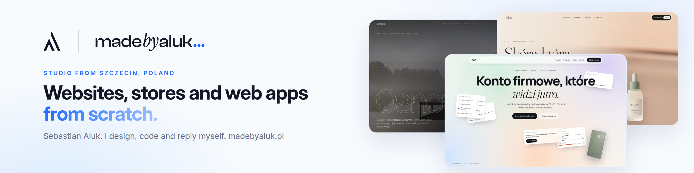
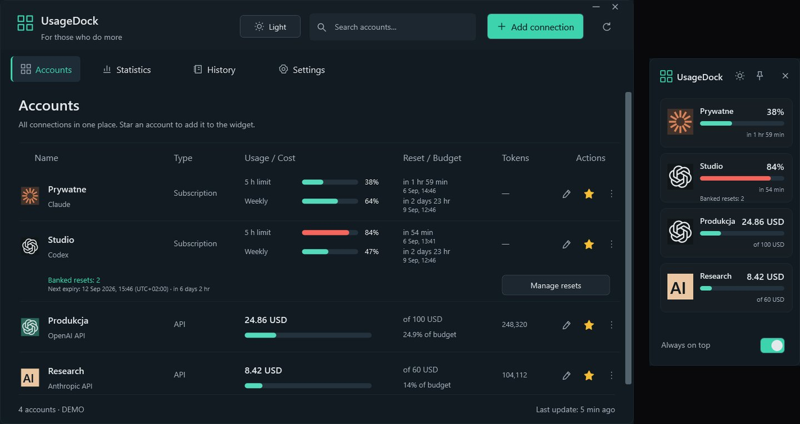

<b>English</b> · <a href="https://github.com/legitedeV/legitedeV/blob/main/README.pl.md">Polski</a> · <a href="https://github.com/legitedeV/legitedeV/blob/main/README.de.md">Deutsch</a> · <a href="https://github.com/legitedeV/legitedeV/blob/main/README.es.md">Español</a> · <a href="https://github.com/legitedeV/legitedeV/blob/main/README.fr.md">Français</a> · <a href="https://github.com/legitedeV/legitedeV/blob/main/README.it.md">Italiano</a> · <a href="https://github.com/legitedeV/legitedeV/blob/main/README.pt.md">Português</a> · <a href="https://github.com/legitedeV/legitedeV/blob/main/README.uk.md">Українська</a> · <a href="https://github.com/legitedeV/legitedeV/blob/main/README.zh.md">中文</a>

  

<h1 align="center">made by ALUK · Sebastian Aluk</h1>

<b>I design and build websites, online stores and web apps. On my own, from the first call to launch.</b>

  
  
  

I run ALUK from Szczecin, Poland. I design, write the code and answer messages myself. No sales rep, no middlemen. Everything in writing. The code, domain and access are yours from the first handover.

## How I work

1. **Getting to know you.** We talk online. I ask about your goal, your clients and your competitors.
2. **Preview.** I show you how the site will look. Before I give you a price.
3. **Quote.** One price, in writing. It doesn't change after you accept it. I start after a 50% deposit.
4. **Build.** I write the code. You have a preview link the whole time.
5. **Launch.** You accept the site and pay the second half. Then I publish it. I fix bugs for 30 days at no extra cost.

## First projects

My portfolio is concept work for now. Now I want to show sites that work for real companies. So I'll build the first few at a lower price. In return I ask for three things:

- permission to show the site in my portfolio,
- a Google review once the site is live,
- a “Design and build: madebyaluk.pl” link in the footer.

**[Tell me about your company](https://madebyaluk.pl/kontakt?utm_source=github&utm_medium=social&utm_campaign=marka-2026q4)**

## Made-up brands. Real websites.

I invented these brands for my portfolio. Each site is live at its own address, so you can open it and scroll. Plain HTML, CSS, GSAP and Lenis, no framework.

<table>
  <tr>
    <td width="50%" valign="top">
      
      <b><a href="https://halda.madebyaluk.pl">Halda</a> · serum brand</b> 
      It opens on a single drop. As you scroll, the bottle turns and shows three ingredients.
    </td>
    <td width="50%" valign="top">
      
      <b><a href="https://osnowa.madebyaluk.pl">Osnowa</a> · architecture studio</b> 
      A pavilion in the fog. Projects change with hard cuts, like in a film. The floor plan draws itself as you scroll.
    </td>
  </tr>
  <tr>
    <td width="50%" valign="top">
      
      <b><a href="https://nurt.madebyaluk.pl">Nurt</a> · business bank account</b> 
      As you scroll, dashboard tiles assemble into the app screen. The forecast chart draws itself.
    </td>
    <td width="50%" valign="top">
      
      <b><a href="https://zgielk.madebyaluk.pl">ZGIEŁK</a> · music festival</b> 
      Title letters react to the mouse and scrolling. The line-up, then a countdown and tickets.
    </td>
  </tr>
  <tr>
    <td width="50%" valign="top">
      
      <b><a href="https://kancelaria.madebyaluk.pl">Sowa &amp; Wróbel</a> · law firm, two versions</b> 
      The same site twice. Version A has no script at all. Version B has subtle motion.
    </td>
    <td width="50%" valign="top">
      
      <b><a href="https://madebyaluk.pl/?utm_source=github&utm_medium=social&utm_campaign=marka-2026q4">madebyaluk.pl</a> · my studio website</b> 
      Next.js, React, TypeScript, Tailwind. A free website audit, a project panel for clients, a short contact form.
    </td>
  </tr>
</table>

## Open source

**[UsageDock](https://github.com/legitedeV/UsageDock)** · Windows, C# / WPF, .NET 8, MIT. Claude and Codex limits, banked Codex resets and API spending in one native Windows window and an always-on-top widget. Five languages, light and dark theme. Keys stay encrypted on your computer. No server of its own, no telemetry. [Download for Windows](https://github.com/legitedeV/UsageDock/releases/latest).

- **MaxSwitch**: automatic switching between Claude Max subscriptions when limits run out (private repo).
- **mcp-humanizer**: MCP server that makes Polish text sound human, without its own API (private repo).

## Stack

  

---

A few sentences are enough. I'll ask about the rest. It doesn't commit you to anything. <a href="mailto:hello@madebyaluk.pl">hello@madebyaluk.pl</a> · <a href="https://madebyaluk.pl/kontakt?utm_source=github&utm_medium=social&utm_campaign=marka-2026q4">write to me at madebyaluk.pl</a> · <a href="https://useme.com/pl/roles/contractor/aluk-sebastian-aluk,675100/">Useme</a>

