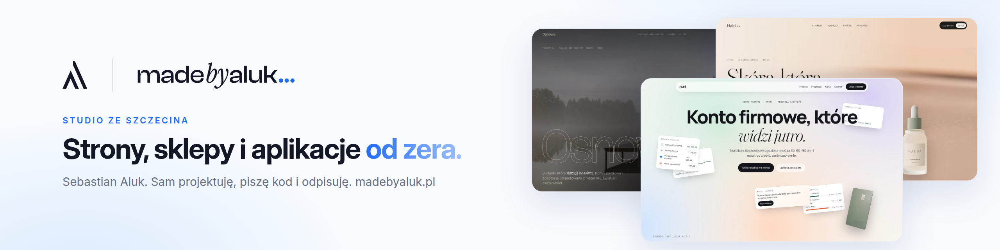
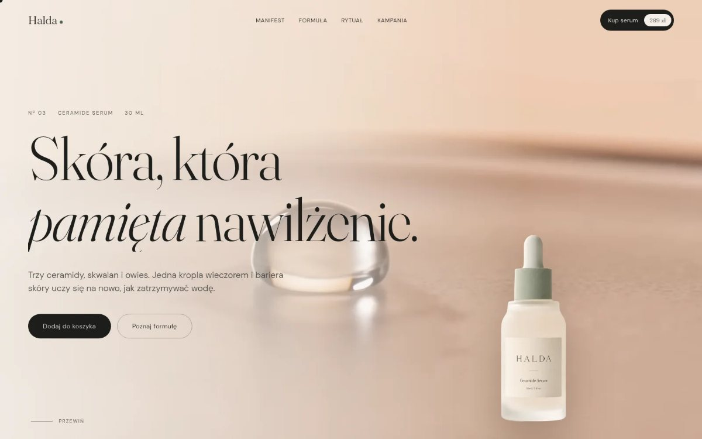
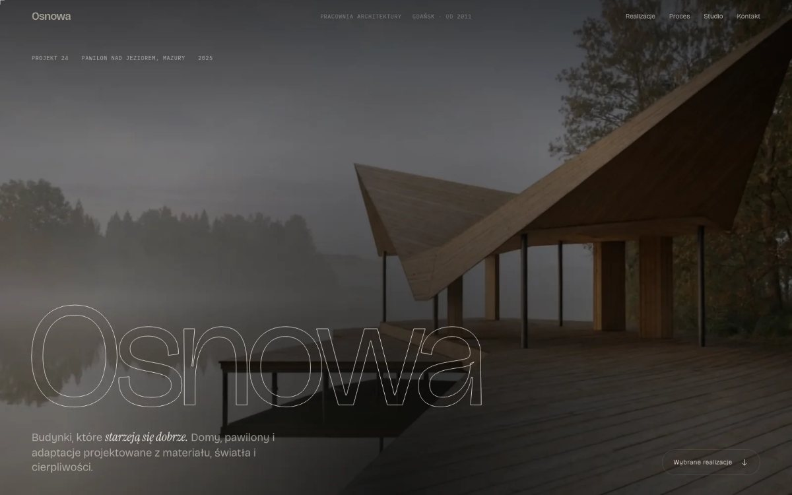
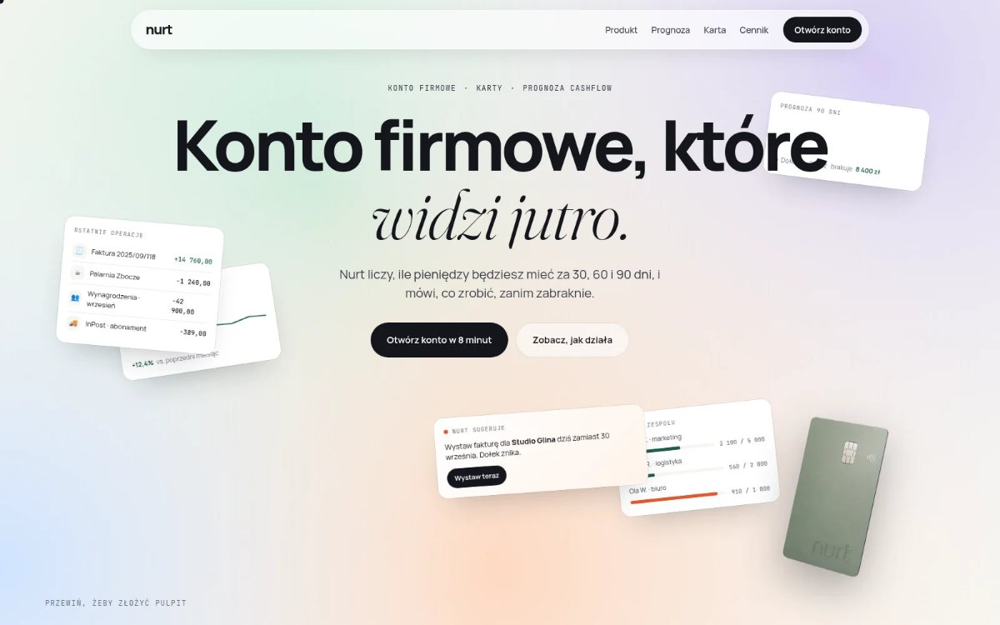
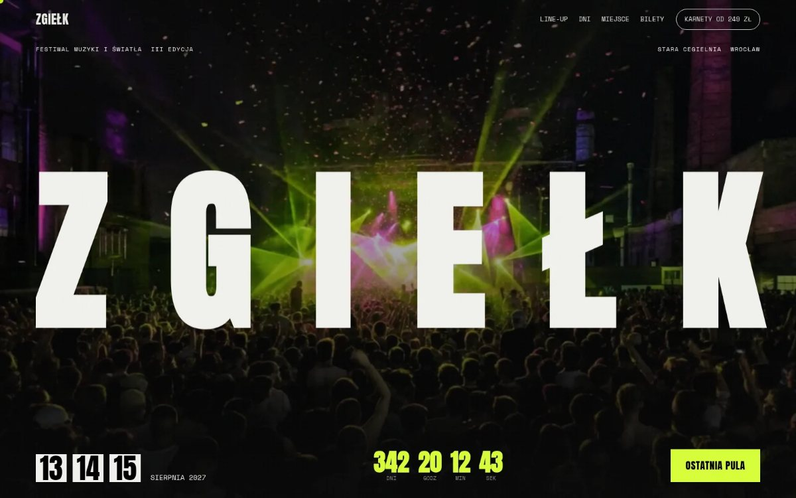
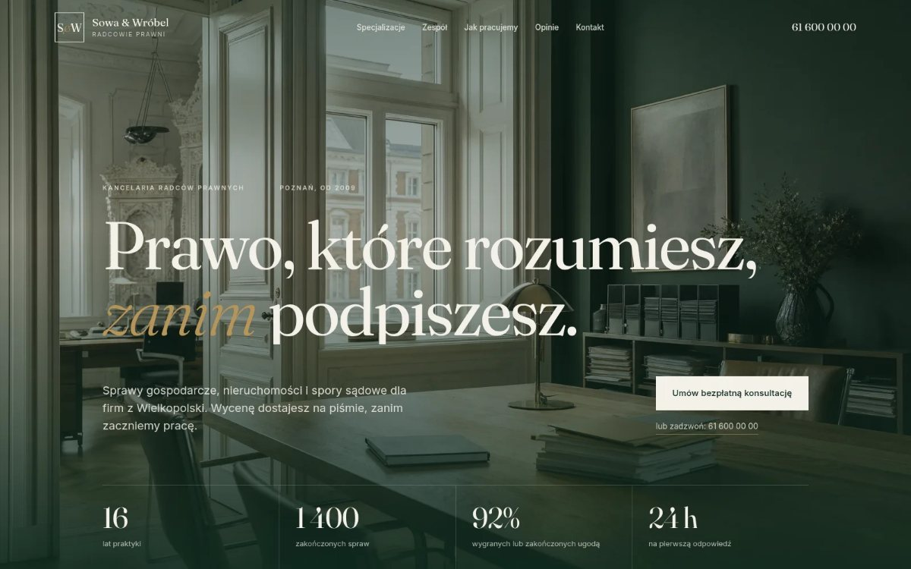
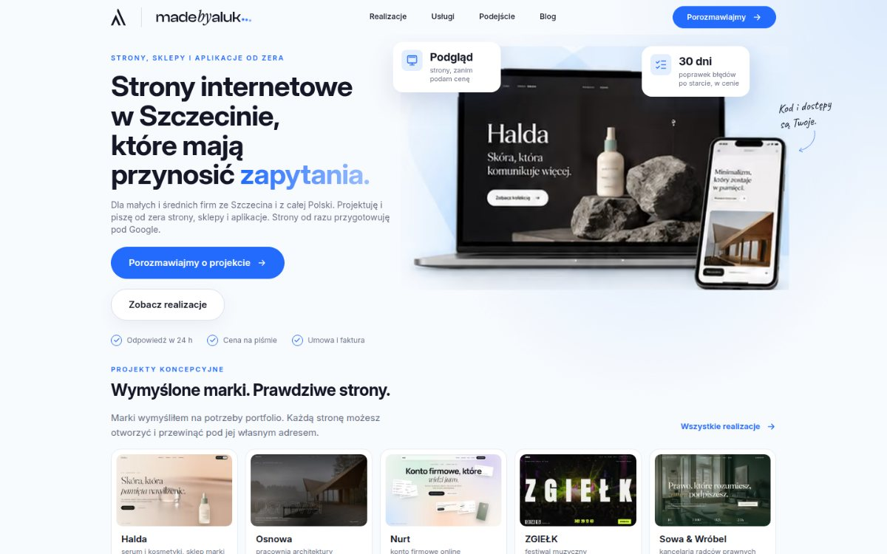
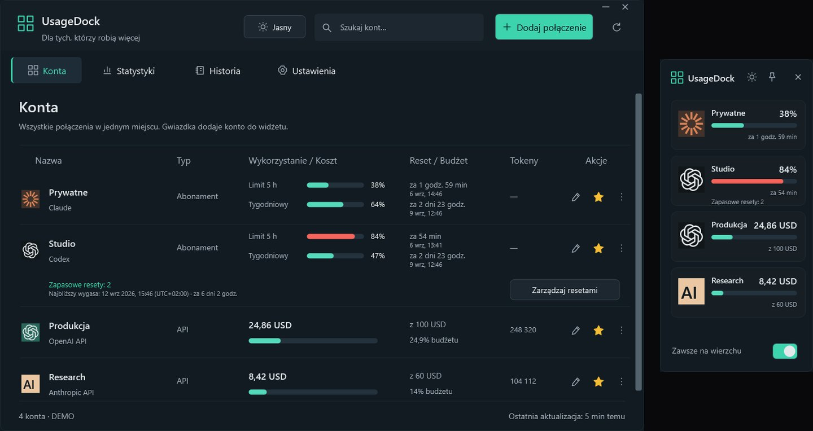

<a href="https://github.com/legitedeV/legitedeV/blob/main/README.md">English</a> · <b>Polski</b> · <a href="https://github.com/legitedeV/legitedeV/blob/main/README.de.md">Deutsch</a> · <a href="https://github.com/legitedeV/legitedeV/blob/main/README.es.md">Español</a> · <a href="https://github.com/legitedeV/legitedeV/blob/main/README.fr.md">Français</a> · <a href="https://github.com/legitedeV/legitedeV/blob/main/README.it.md">Italiano</a> · <a href="https://github.com/legitedeV/legitedeV/blob/main/README.pt.md">Português</a> · <a href="https://github.com/legitedeV/legitedeV/blob/main/README.uk.md">Українська</a> · <a href="https://github.com/legitedeV/legitedeV/blob/main/README.zh.md">中文</a>

  

<h1 align="center">made by ALUK · Sebastian Aluk</h1>

<b>Projektuję i piszę strony, sklepy i aplikacje dla firm. Sam, od pierwszej rozmowy do startu.</b>

  
  
  

Prowadzę ALUK ze Szczecina. Sam projektuję, piszę kod i odpisuję na wiadomości. Bez handlowca i pośredników. Wszystko na piśmie. Kod, domena i dostępy są Twoje od pierwszego odbioru.

## Jak pracuję

1. **Poznanie.** Rozmawiamy online. Pytam o cel, Twoich klientów i konkurencję.
2. **Podgląd.** Pokazuję, jak strona będzie wyglądać. Zanim podam cenę.
3. **Wycena.** Jedna cena, na piśmie. Po akceptacji się nie zmienia. Zaczynam po wpłacie 50% zaliczki.
4. **Budowa.** Piszę kod. Link do podglądu masz przez cały czas.
5. **Start.** Akceptujesz stronę i wpłacasz drugą połowę. Wtedy ją publikuję. Przez 30 dni poprawiam błędy bez dopłaty.

## Pierwsze realizacje

Moje portfolio to na razie projekty koncepcyjne. Teraz chcę pokazać strony, które pracują dla prawdziwych firm. Dlatego kilku pierwszym firmom zrobię stronę taniej. W zamian proszę o trzy rzeczy:

- zgodę na pokazanie strony w realizacjach,
- opinię w Google, gdy strona już działa,
- link „Projekt i wykonanie madebyaluk.pl” w stopce strony.

**[Zgłoś swoją firmę](https://madebyaluk.pl/kontakt?utm_source=github&utm_medium=social&utm_campaign=marka-2026q4)**

## Wymyślone marki. Prawdziwe strony.

Marki wymyśliłem na potrzeby portfolio. Każdą stronę możesz otworzyć i przewinąć pod jej własnym adresem. Czysty HTML, CSS, GSAP i Lenis, bez frameworka.

<table>
  <tr>
    <td width="50%" valign="top">
      
      <b><a href="https://halda.madebyaluk.pl">Halda</a> · marka serum</b> 
      Na starcie kropla. Gdy przewijasz, butelka się obraca i pokazuje trzy składniki.
    </td>
    <td width="50%" valign="top">
      
      <b><a href="https://osnowa.madebyaluk.pl">Osnowa</a> · pracownia architektów</b> 
      Pawilon we mgle. Projekty zmieniają się twardym cięciem, jak w filmie. Plan budynku rysuje się, gdy przewijasz.
    </td>
  </tr>
  <tr>
    <td width="50%" valign="top">
      
      <b><a href="https://nurt.madebyaluk.pl">Nurt</a> · konto firmowe</b> 
      Gdy przewijasz, kafelki składają się w ekran aplikacji. Wykres prognozy rysuje się sam.
    </td>
    <td width="50%" valign="top">
      
      <b><a href="https://zgielk.madebyaluk.pl">ZGIEŁK</a> · festiwal muzyczny</b> 
      Litery tytułu reagują na mysz i przewijanie. Potem artyści, odliczanie i bilety.
    </td>
  </tr>
  <tr>
    <td width="50%" valign="top">
      
      <b><a href="https://kancelaria.madebyaluk.pl">Sowa &amp; Wróbel</a> · kancelaria, dwie wersje</b> 
      Ta sama strona dwa razy. Wersja A nie ma żadnego skryptu. Wersja B ma delikatny ruch.
    </td>
    <td width="50%" valign="top">
      
      <b><a href="https://madebyaluk.pl/?utm_source=github&utm_medium=social&utm_campaign=marka-2026q4">madebyaluk.pl</a> · strona mojego studia</b> 
      Next.js, React, TypeScript, Tailwind. Bezpłatny audyt strony, panel projektu dla klienta, krótki formularz.
    </td>
  </tr>
</table>

## Open source

**[UsageDock](https://github.com/legitedeV/UsageDock)** · Windows, C# / WPF, .NET 8, MIT. Limity Claude i Codex, zapasowe resety Codex i wydatki na API w jednym oknie Windows i widżecie zawsze na wierzchu. Pięć języków, jasny i ciemny motyw. Klucze zostają zaszyfrowane na Twoim komputerze. Bez własnego serwera i telemetrii. [Pobierz dla Windows](https://github.com/legitedeV/UsageDock/releases/latest).

- **MaxSwitch**: samo przełącza subskrypcje Claude Max, gdy kończą się limity (repo prywatne).
- **mcp-humanizer**: serwer MCP, który sprawia, że polski tekst brzmi po ludzku, bez własnego API (repo prywatne).

## Narzędzia

  

---

Wystarczy kilka zdań, resztę dopytam. Do niczego Cię to nie zobowiązuje. <a href="mailto:hello@madebyaluk.pl">hello@madebyaluk.pl</a> · <a href="https://madebyaluk.pl/kontakt?utm_source=github&utm_medium=social&utm_campaign=marka-2026q4">napisz przez madebyaluk.pl</a> · <a href="https://useme.com/pl/roles/contractor/aluk-sebastian-aluk,675100/">Useme</a>

