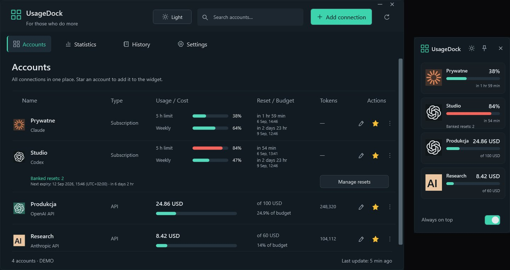

<a href="https://github.com/legitedeV/legitedeV/blob/main/README.md">English</a> · <a href="https://github.com/legitedeV/legitedeV/blob/main/README.pl.md">Polski</a> · <a href="https://github.com/legitedeV/legitedeV/blob/main/README.de.md">Deutsch</a> · <a href="https://github.com/legitedeV/legitedeV/blob/main/README.es.md">Español</a> · <a href="https://github.com/legitedeV/legitedeV/blob/main/README.fr.md">Français</a> · <a href="https://github.com/legitedeV/legitedeV/blob/main/README.it.md">Italiano</a> · <b>Português</b> · <a href="https://github.com/legitedeV/legitedeV/blob/main/README.uk.md">Українська</a> · <a href="https://github.com/legitedeV/legitedeV/blob/main/README.zh.md">中文</a>

  

<h1 align="center">made by ALUK · Sebastian Aluk</h1>

<b>Desenho e construo sites, lojas online e aplicações web. Sozinho, da primeira conversa ao lançamento.</b>

  
  
  

Dirijo a ALUK a partir de Szczecin, na Polónia. Desenho, escrevo o código e respondo às mensagens eu mesmo. Sem comerciais nem intermediários. Tudo por escrito. O código, o domínio e os acessos são seus desde a primeira entrega.

## Como trabalho

1. **Conhecer.** Falamos online. Pergunto pelo objetivo, pelos seus clientes e pela concorrência.
2. **Pré-visualização.** Mostro como o site vai ficar. Antes de dar um preço.
3. **Orçamento.** Um só preço, por escrito. Depois de aceite, não muda. Começo após um sinal de 50%.
4. **Construção.** Escrevo o código. Tem um link de pré-visualização o tempo todo.
5. **Lançamento.** Aprova o site e paga a segunda metade. Aí publico-o. Durante 30 dias corrijo erros sem custo extra.

## Primeiros projetos

Por enquanto o meu portfólio é feito de conceitos. Agora quero mostrar sites que trabalham para empresas reais. Por isso farei os primeiros a um preço mais baixo. Em troca peço três coisas:

- autorização para mostrar o site no portfólio,
- uma avaliação no Google quando o site estiver no ar,
- um link «Design e desenvolvimento: madebyaluk.pl» no rodapé.

**[Fale-me da sua empresa](https://madebyaluk.pl/kontakt?utm_source=github&utm_medium=social&utm_campaign=marka-2026q4)**

## Marcas inventadas. Sites reais.

Inventei estas marcas para o meu portfólio. Cada site está publicado no seu próprio endereço, pode abri-lo e percorrê-lo. HTML, CSS, GSAP e Lenis, sem framework.

<table>
  <tr>
    <td width="50%" valign="top">
      
      <b><a href="https://halda.madebyaluk.pl">Halda</a> · marca de sérum</b> 
      Abre com uma gota. Ao percorrer, o frasco roda e mostra três ingredientes.
    </td>
    <td width="50%" valign="top">
      
      <b><a href="https://osnowa.madebyaluk.pl">Osnowa</a> · atelier de arquitetura</b> 
      Um pavilhão no nevoeiro. Os projetos mudam com cortes secos, como num filme. A planta desenha-se ao percorrer.
    </td>
  </tr>
  <tr>
    <td width="50%" valign="top">
      
      <b><a href="https://nurt.madebyaluk.pl">Nurt</a> · conta empresarial</b> 
      Ao percorrer, os blocos juntam-se no ecrã da aplicação. O gráfico de previsão desenha-se sozinho.
    </td>
    <td width="50%" valign="top">
      
      <b><a href="https://zgielk.madebyaluk.pl">ZGIEŁK</a> · festival de música</b> 
      As letras do título reagem ao rato e ao scroll. Depois o cartaz, a contagem decrescente e os bilhetes.
    </td>
  </tr>
  <tr>
    <td width="50%" valign="top">
      
      <b><a href="https://kancelaria.madebyaluk.pl">Sowa &amp; Wróbel</a> · escritório de advogados, duas versões</b> 
      O mesmo site duas vezes. A versão A não tem nenhum script. A versão B tem movimento subtil.
    </td>
    <td width="50%" valign="top">
      
      <b><a href="https://madebyaluk.pl/?utm_source=github&utm_medium=social&utm_campaign=marka-2026q4">madebyaluk.pl</a> · o site do meu estúdio</b> 
      Next.js, React, TypeScript, Tailwind. Auditoria gratuita ao site, painel de projeto para clientes, formulário curto.
    </td>
  </tr>
</table>

## Código aberto

**[UsageDock](https://github.com/legitedeV/UsageDock)** · Windows, C# / WPF, .NET 8, MIT. Limites do Claude e do Codex, resets do Codex guardados e gastos em API numa janela nativa do Windows e num widget sempre visível. Cinco idiomas, tema claro e escuro. As chaves ficam cifradas no seu computador. Sem servidor próprio, sem telemetria. [Transferir para Windows](https://github.com/legitedeV/UsageDock/releases/latest).

- **MaxSwitch**: alterna sozinho entre subscrições Claude Max quando os limites acabam (repo privado).
- **mcp-humanizer**: servidor MCP que torna humano o texto em polaco, sem API própria (repo privado).

## Ferramentas

  

---

Bastam algumas frases. O resto pergunto eu. Não o compromete a nada. <a href="mailto:hello@madebyaluk.pl">hello@madebyaluk.pl</a> · <a href="https://madebyaluk.pl/kontakt?utm_source=github&utm_medium=social&utm_campaign=marka-2026q4">escreva-me em madebyaluk.pl</a> · <a href="https://useme.com/pl/roles/contractor/aluk-sebastian-aluk,675100/">Useme</a>

