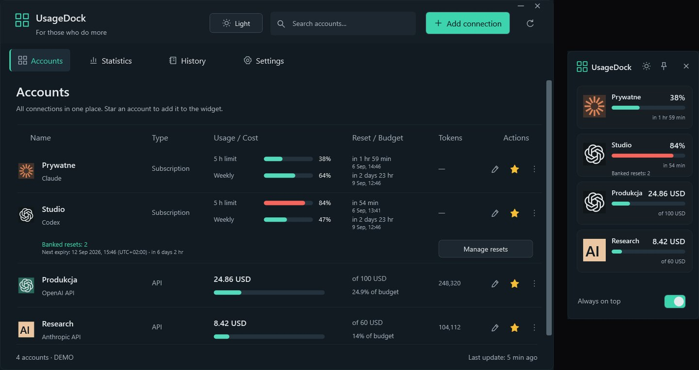

<a href="https://github.com/legitedeV/legitedeV/blob/main/README.md">English</a> · <a href="https://github.com/legitedeV/legitedeV/blob/main/README.pl.md">Polski</a> · <a href="https://github.com/legitedeV/legitedeV/blob/main/README.de.md">Deutsch</a> · <a href="https://github.com/legitedeV/legitedeV/blob/main/README.es.md">Español</a> · <a href="https://github.com/legitedeV/legitedeV/blob/main/README.fr.md">Français</a> · <a href="https://github.com/legitedeV/legitedeV/blob/main/README.it.md">Italiano</a> · <a href="https://github.com/legitedeV/legitedeV/blob/main/README.pt.md">Português</a> · <b>Українська</b> · <a href="https://github.com/legitedeV/legitedeV/blob/main/README.zh.md">中文</a>

  

<h1 align="center">made by ALUK · Sebastian Aluk</h1>

<b>Проєктую та створюю сайти, інтернет-магазини й вебзастосунки. Сам, від першої розмови до запуску.</b>

  
  
  

Я веду ALUK зі Щецина, Польща. Сам проєктую, пишу код і відповідаю на повідомлення. Без менеджерів і посередників. Усе письмово. Код, домен і доступи належать вам від першої передачі.

## Як я працюю

1. **Знайомство.** Говоримо онлайн. Питаю про мету, ваших клієнтів і конкурентів.
2. **Попередній перегляд.** Показую, як виглядатиме сайт. Ще до того, як назву ціну.
3. **Кошторис.** Одна ціна, письмово. Після погодження вона не змінюється. Починаю після передоплати 50%.
4. **Створення.** Пишу код. Посилання на перегляд у вас є весь час.
5. **Запуск.** Ви приймаєте сайт і сплачуєте другу половину. Тоді я його публікую. 30 днів виправляю помилки без доплати.

## Перші проєкти

Поки що моє портфоліо складається з концептів. Тепер хочу показати сайти, які працюють на справжні компанії. Тому кілька перших зроблю дешевше. Натомість прошу про три речі:

- дозвіл показати сайт у портфоліо,
- відгук у Google, коли сайт уже працює,
- посилання «Дизайн і розробка: madebyaluk.pl» у футері.

**[Розкажіть про свою компанію](https://madebyaluk.pl/kontakt?utm_source=github&utm_medium=social&utm_campaign=marka-2026q4)**

## Вигадані бренди. Справжні сайти.

Ці бренди я вигадав для портфоліо. Кожен сайт працює за власною адресою, його можна відкрити й прогорнути. Чистий HTML, CSS, GSAP і Lenis, без фреймворку.

<table>
  <tr>
    <td width="50%" valign="top">
      
      <b><a href="https://halda.madebyaluk.pl">Halda</a> · бренд сироватки</b> 
      Починається з краплі. Коли гортаєте, флакон обертається й показує три інгредієнти.
    </td>
    <td width="50%" valign="top">
      
      <b><a href="https://osnowa.madebyaluk.pl">Osnowa</a> · архітектурне бюро</b> 
      Павільйон у тумані. Проєкти змінюються різкими склейками, як у кіно. План будинку малюється під час гортання.
    </td>
  </tr>
  <tr>
    <td width="50%" valign="top">
      
      <b><a href="https://nurt.madebyaluk.pl">Nurt</a> · бізнес-рахунок</b> 
      Коли гортаєте, плитки складаються в екран застосунку. Графік прогнозу малюється сам.
    </td>
    <td width="50%" valign="top">
      
      <b><a href="https://zgielk.madebyaluk.pl">ZGIEŁK</a> · музичний фестиваль</b> 
      Літери назви реагують на мишу й гортання. Далі лайн-ап, зворотний відлік і квитки.
    </td>
  </tr>
  <tr>
    <td width="50%" valign="top">
      
      <b><a href="https://kancelaria.madebyaluk.pl">Sowa &amp; Wróbel</a> · юридична фірма, дві версії</b> 
      Той самий сайт двічі. Версія A не має жодного скрипту. Версія B має делікатний рух.
    </td>
    <td width="50%" valign="top">
      
      <b><a href="https://madebyaluk.pl/?utm_source=github&utm_medium=social&utm_campaign=marka-2026q4">madebyaluk.pl</a> · сайт моєї студії</b> 
      Next.js, React, TypeScript, Tailwind. Безкоштовний аудит сайту, панель проєкту для клієнта, коротка форма.
    </td>
  </tr>
</table>

## Відкритий код

**[UsageDock](https://github.com/legitedeV/UsageDock)** · Windows, C# / WPF, .NET 8, MIT. Ліміти Claude і Codex, збережені скидання Codex і витрати на API в одному нативному вікні Windows та віджеті поверх усіх вікон. П’ять мов, світла й темна тема. Ключі залишаються зашифрованими на вашому комп’ютері. Без власного сервера й телеметрії. [Завантажити для Windows](https://github.com/legitedeV/UsageDock/releases/latest).

- **MaxSwitch**: сам перемикає підписки Claude Max, коли закінчуються ліміти (приватний репозиторій).
- **mcp-humanizer**: MCP-сервер, що робить польський текст людяним, без власного API (приватний репозиторій).

## Інструменти

  

---

Досить кількох речень. Решту я уточню. Це ні до чого вас не зобов’язує. <a href="mailto:hello@madebyaluk.pl">hello@madebyaluk.pl</a> · <a href="https://madebyaluk.pl/kontakt?utm_source=github&utm_medium=social&utm_campaign=marka-2026q4">напишіть через madebyaluk.pl</a> · <a href="https://useme.com/pl/roles/contractor/aluk-sebastian-aluk,675100/">Useme</a>

