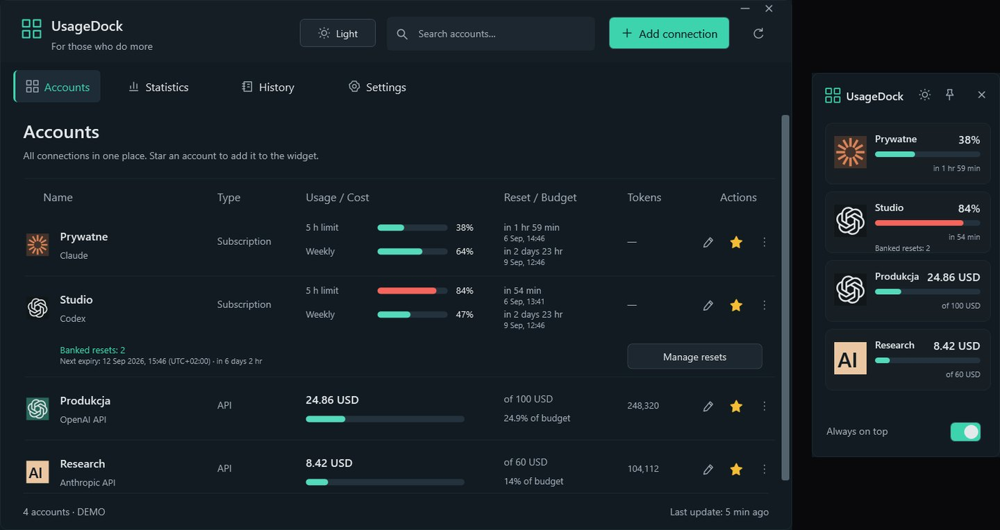

<a href="https://github.com/legitedeV/legitedeV/blob/main/README.md">English</a> · <a href="https://github.com/legitedeV/legitedeV/blob/main/README.pl.md">Polski</a> · <a href="https://github.com/legitedeV/legitedeV/blob/main/README.de.md">Deutsch</a> · <a href="https://github.com/legitedeV/legitedeV/blob/main/README.es.md">Español</a> · <a href="https://github.com/legitedeV/legitedeV/blob/main/README.fr.md">Français</a> · <a href="https://github.com/legitedeV/legitedeV/blob/main/README.it.md">Italiano</a> · <a href="https://github.com/legitedeV/legitedeV/blob/main/README.pt.md">Português</a> · <a href="https://github.com/legitedeV/legitedeV/blob/main/README.uk.md">Українська</a> · <b>中文</b>

  

<h1 align="center">made by ALUK · Sebastian Aluk</h1>

<b>我设计并开发网站、网店和 Web 应用。从第一次沟通到上线，全程由我一人完成。</b>

  
  
  

我在波兰什切青经营 ALUK。设计、写代码、回复消息，都由我亲自来做。没有销售，没有中间人。一切以书面为准。代码、域名和权限从第一次交付起就归你所有。

## 我的工作方式

1. **了解。** 我们在线沟通。我会问你的目标、客户和竞争对手。
2. **预览。** 先给你看网站的样子，再报价。
3. **报价。** 一个价格，书面确认。确认后不再变动。支付 50% 定金后开工。
4. **开发。** 我写代码。整个过程中你都有预览链接。
5. **上线。** 你验收网站并支付另一半，我随即发布。30 天内免费修复错误。

## 首批项目

目前我的作品集都是概念项目。现在我想展示为真实企业工作的网站。所以前几家企业可以享受更低的价格。作为交换，我请你做三件事：

- 允许我在作品集中展示网站；
- 网站上线后在 Google 留下评价；
- 在页脚放上“设计与开发：madebyaluk.pl”链接。

**[介绍一下你的公司](https://madebyaluk.pl/kontakt?utm_source=github&utm_medium=social&utm_campaign=marka-2026q4)**

## 虚构的品牌，真实的网站。

这些品牌是我为作品集虚构的。每个网站都有自己的地址，可以打开并滚动浏览。纯 HTML、CSS、GSAP 和 Lenis，不用框架。

<table>
  <tr>
    <td width="50%" valign="top">
      
      <b><a href="https://halda.madebyaluk.pl">Halda</a> · 精华液品牌</b> 
      以一滴精华开场。滚动时，瓶子旋转并展示三种成分。
    </td>
    <td width="50%" valign="top">
      
      <b><a href="https://osnowa.madebyaluk.pl">Osnowa</a> · 建筑事务所</b> 
      雾中的亭子。项目像电影一样硬切换。滚动时平面图逐步绘出。
    </td>
  </tr>
  <tr>
    <td width="50%" valign="top">
      
      <b><a href="https://nurt.madebyaluk.pl">Nurt</a> · 企业账户</b> 
      滚动时，面板拼合成应用界面。预测图表自动绘出。
    </td>
    <td width="50%" valign="top">
      
      <b><a href="https://zgielk.madebyaluk.pl">ZGIEŁK</a> · 音乐节</b> 
      标题字母随鼠标和滚动而动。随后是阵容、倒计时和购票。
    </td>
  </tr>
  <tr>
    <td width="50%" valign="top">
      
      <b><a href="https://kancelaria.madebyaluk.pl">Sowa &amp; Wróbel</a> · 律师事务所，两个版本</b> 
      同一个网站做两遍。A 版没有任何脚本，B 版有细腻的动效。
    </td>
    <td width="50%" valign="top">
      
      <b><a href="https://madebyaluk.pl/?utm_source=github&utm_medium=social&utm_campaign=marka-2026q4">madebyaluk.pl</a> · 我的工作室网站</b> 
      Next.js、React、TypeScript、Tailwind。免费网站审计、客户项目面板、简短的联系表单。
    </td>
  </tr>
</table>

## 开源

**[UsageDock](https://github.com/legitedeV/UsageDock)** · Windows, C# / WPF, .NET 8, MIT. 在一个原生 Windows 窗口和置顶小组件中查看 Claude 与 Codex 的额度、储备的 Codex 重置次数和 API 支出。五种语言，浅色与深色主题。密钥加密保存在你的电脑上。没有自有服务器，没有遥测。 [下载 Windows 版](https://github.com/legitedeV/UsageDock/releases/latest).

- **MaxSwitch**: 在 Claude Max 订阅额度用尽时自动切换（私有仓库）。
- **mcp-humanizer**: 让波兰语文本读起来更自然的 MCP 服务器，无需自有 API（私有仓库）。

## 工具

  

---

写几句话就够了，其余的我来问。不构成任何承诺。 <a href="mailto:hello@madebyaluk.pl">hello@madebyaluk.pl</a> · <a href="https://madebyaluk.pl/kontakt?utm_source=github&utm_medium=social&utm_campaign=marka-2026q4">通过 madebyaluk.pl 联系我</a> · <a href="https://useme.com/pl/roles/contractor/aluk-sebastian-aluk,675100/">Useme</a>

